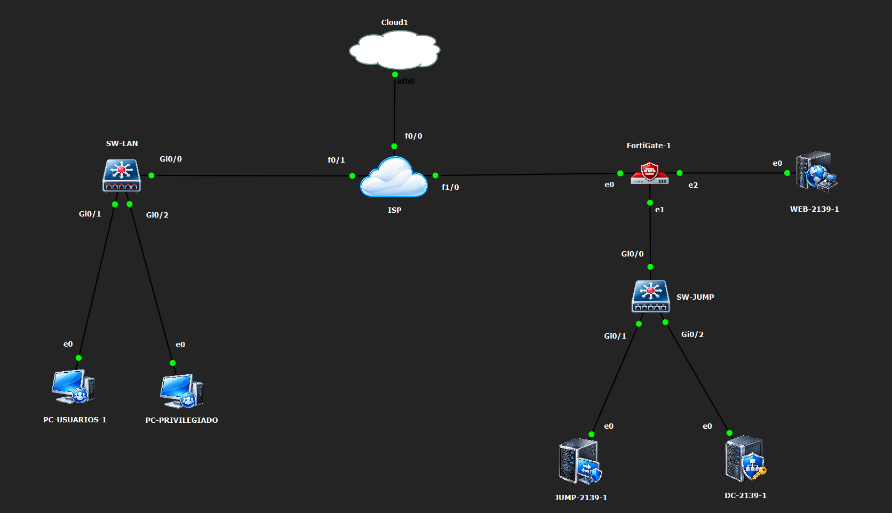

# Práctica 3 · Infraestructura 2 · VPN y Jump Server

## Video demostrativo

[▶ Ver video demostrativo en YouTube](https://youtu.be/gYIoC38Pk3w)

**Autor:** Adrian Magallanes Feliz · **Asignación individual** · **Base de direccionamiento:** últimos cuatro dígitos de matrícula **2139**.

## Propósito

Implementar y demostrar acceso remoto controlado a un sistema de Caja. Dos clientes Ubuntu establecen una VPN IPsec hacia FortiGate y acceden únicamente al Jump Server. Desde ese servidor, las aplicaciones publicadas permiten acceder al Web Server mediante HTTPS, RDP y SSH, según el perfil del usuario.

El control combina segmentación de red, políticas del FortiGate, grupos de Active Directory, publicación de RemoteApp y una regla explícita de Windows Firewall que bloquea SSH para el usuario sin privilegios.

## Topología implementada en GNS3

[Ver diagrama lógico con direccionamiento](diagramas/topologia.svg)

## Componentes y direccionamiento

| Componente | Dirección / red | Función |
|---|---|---|
| Usuarios Ubuntu, VLAN 10 | `10.21.39.0/25`, DHCP `.10–.100` | Clientes remotos; gateway `10.21.39.1` |
| ISP FastEthernet0/1 | `10.21.39.1/25` | Gateway y DHCP de usuarios |
| ISP FastEthernet1/0 | `203.0.113.1/30` | Enlace hacia FortiGate |
| FortiGate port1 | `203.0.113.2/30` | Terminación VPN |
| FortiGate port2 | `10.21.39.129/29` | Gateway de LAN Jump/DC |
| JUMP-2139 | `10.21.39.130/29` | RDS, RemoteApp, Gateway y Web Client |
| DC-2139 | `10.21.39.131/29` | AD DS y DNS de `infra2139.test` |
| FortiGate port3 | `10.21.39.137/29` | Gateway de LAN Web |
| WEB-2139 | `10.21.39.138/29` | Caja sobre IIS HTTPS, RDP y OpenSSH |
| Clientes dentro de VPN | `10.21.39.200–10.21.39.210` | Direcciones virtuales; destino de túnel `.130/32` |
| ISP FastEthernet0/0 | DHCP; observado `192.168.85.190/24` | Enlace a nube VMware NAT |

`203.0.113.0/30` es un **segmento de documentación que simula el enlace público del ISP**, no un bloque público asignado ni accesible desde Internet. El DC es un servidor auxiliar adicional a los dos servidores requeridos.

## Control de acceso

| Origen / identidad | Destino | Servicios / aplicaciones | Resultado previsto |
|---|---|---|---|
| Clientes VPN | Jump `.130` | HTTPS y RDP | Permitido |
| Clientes VPN | Web / DC | Acceso directo | No permitido por el diseño |
| Jump `.130` | Web `.138` | HTTPS 443, RDP 3389, SSH 22 | Permitido por FortiGate |
| Jump `.130` | Web `.138` | Otros servicios | Denegado explícitamente |
| `usuario2139`, grupo `RDS-Web` | RemoteApp | Sistema de Caja | Publicado |
| `usuario2139` ejecutando procesos en Jump | Cualquier destino TCP/22 | SSH | Bloqueado por Windows Firewall |
| `soporte2139`, grupo `RDS-Admin` | RemoteApp | Caja, PuTTY y RDP | Publicados |

El perfil de soporte tiene aplicaciones administrativas publicadas; no se presenta como miembro de Domain Admins. La autenticación VPN usa PSK; los permisos de RemoteApp se asignan por identidad de dominio al iniciar sesión en RDS.

## Evidencias principales

### Políticas de FortiGate por GUI

### Sistema de Caja mediante RemoteApp

### Bloqueo de SSH por usuario

Todas las capturas incluidas son archivos aportados durante la práctica; el [índice de evidencias](docs/05-evidencias.md) indica qué prueba respalda cada una. Los diagramas son representaciones documentales de la arquitectura.

## Documentación

1. [Arquitectura, cableado y direccionamiento](docs/01-arquitectura.md)
2. [FortiGate: configuración exclusivamente por GUI](docs/02-fortigate-gui.md)
3. [Windows Server, identidades y aplicaciones](docs/03-servidores.md)
4. [Ubuntu, VPN y operación](docs/04-clientes-vpn.md)
5. [Matriz de requisitos y evidencias](docs/05-evidencias.md)
6. [Guion del video y lista rápida de comandos](docs/06-video.md)
7. [Exportación de configuraciones y entrega](docs/07-entrega.md)
8. [Alcance, limitaciones e incidencias](docs/08-alcance.md)

## Código y configuraciones

- [Sistema de Caja HTML/JavaScript](web/index.html): versión reconstruida a partir del código pegado durante la práctica; ventas en `localStorage` del navegador remoto.
- [Scripts y secuencias de comandos](scripts/README.md): Windows, Ubuntu y verificaciones, sin contraseñas.
- [Configuraciones Cisco de referencia](configs/referencia/README.md): reconstrucción documental de la configuración conocida.
- [Respaldo original de FortiGate, saneado para publicación](configs/running-configs/FortiGate-sanitizado.conf).
- [Inventario de configuraciones](configs/running-configs/README.md): distingue los respaldos recibidos de las referencias reconstruidas.
- [Control de entrega y formato del TXT](docs/07-entrega.md).

## Resultados documentados

Las capturas muestran el Web Client abierto desde Ubuntu, el catálogo de aplicaciones según el usuario y aplicaciones ejecutadas en Jump:

| Prueba | Evidencia |
|---|---|
| Usuario normal: solo Caja publicada | [Catálogo RemoteApp](evidencias/04-remoteapp-usuario.png) |
| Caja: venta y cálculo de cambio | [Venta registrada](evidencias/05-caja-venta.png) |
| Soporte: Caja, PuTTY y RDP publicados | [Catálogo de soporte](evidencias/06-remoteapp-soporte.png) |
| SSH hacia WEB-2139 desde PuTTY RemoteApp | [Sesión SSH](evidencias/07-ssh-soporte.png) |
| RDP hacia WEB-2139 mediante Web Client | [Sesión RDP](evidencias/08-rdp-soporte.png) |
| Usuario normal: SSH bloqueado y HTTPS permitido | [Prueba por identidad](evidencias/09-ssh-bloqueado-usuario.png) |

Estas pruebas corresponden al momento de las capturas. El [registro de operación](docs/04-clientes-vpn.md#incidencia-posterior-unable-to-connect) conserva una incidencia posterior de conexión cuya recuperación requiere evidencia adicional; no se presenta como resuelta. Los archivos y comprobaciones que aún faltan se detallan en el [control de entrega](docs/07-entrega.md).

## Entorno de laboratorio

FortiGate VM FortiOS 7.0.9, Windows Server 2019 Evaluation y clientes Ubuntu con strongSwan 5.9.13. La negociación observada utiliza DES/SHA1 por las restricciones del entorno de evaluación; no es una propuesta para producción. Se usan certificados autofirmados y RDS de laboratorio; no se documenta la instalación de CAL de producción. Véanse las [limitaciones](docs/08-alcance.md).
