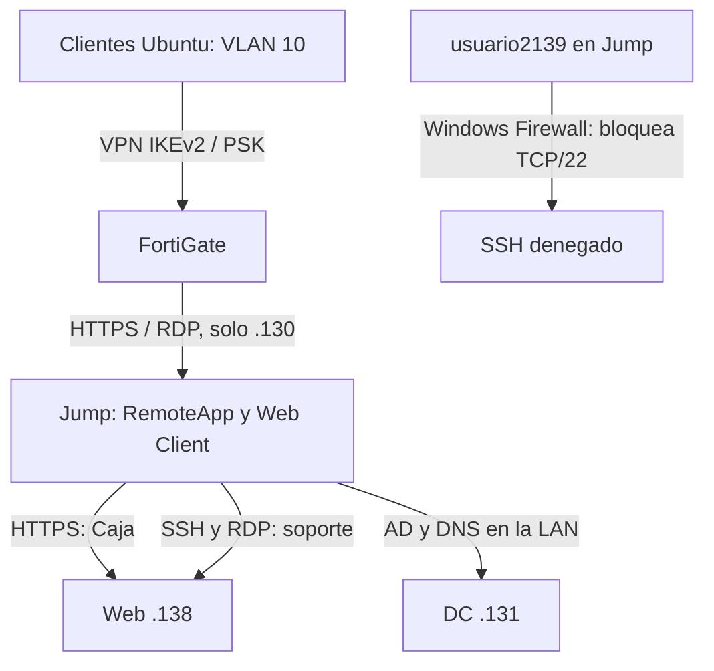

# Flujo lógico de acceso

La identidad se evalúa en RDS/Windows. FortiGate restringe el destino y los servicios. La VPN no da acceso directo a DC ni Web. El flujo AD/DNS entre Jump y DC es local a su LAN.
