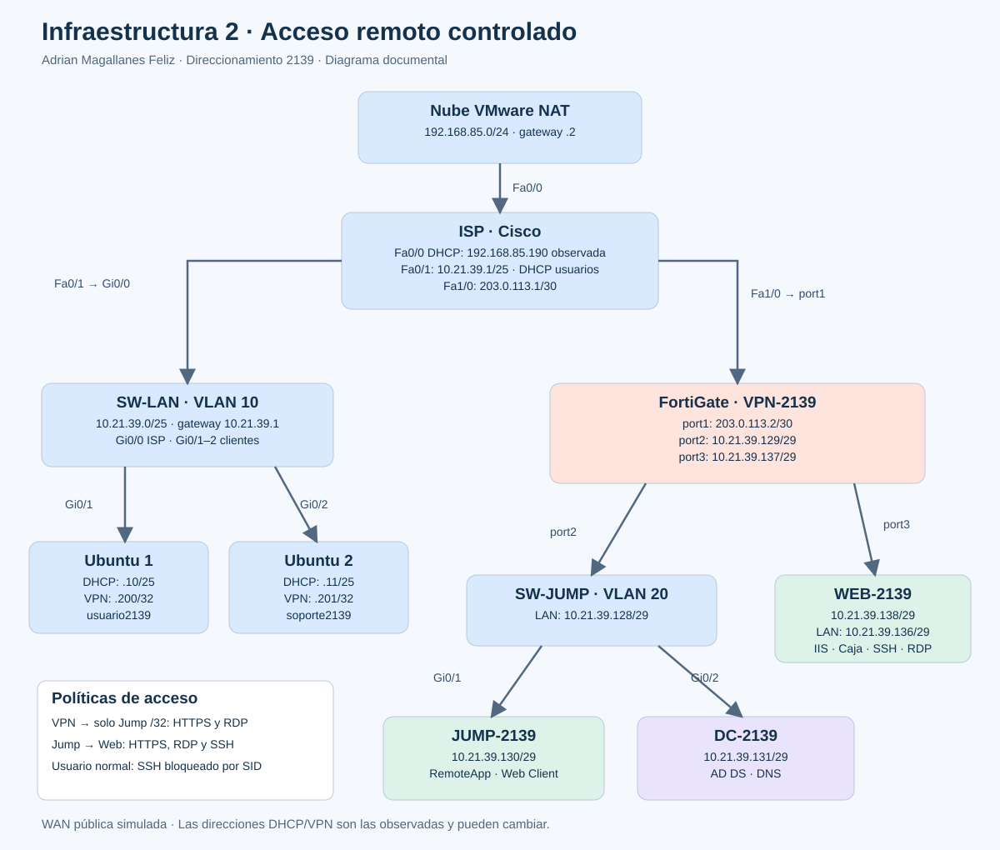

# Arquitectura y direccionamiento

## Objetivo de seguridad

Concentrar la entrada remota en Jump y evitar la exposición directa del Web Server a los clientes. FortiGate controla los servicios entre las redes; Windows aplica los permisos de publicación y el bloqueo SSH por usuario. El tráfico AD/DNS entre Jump y DC permanece en su LAN; la restricción de tres servicios se refiere al tráfico **Jump → Web**, no a toda dependencia del Jump.

## Captura del proyecto GNS3

Los nombres de nodos terminados en `-1` son etiquetas de GNS3; los nombres de sistema de los servidores siguen siendo JUMP-2139, DC-2139 y WEB-2139.

## Diagrama lógico con direccionamiento

## Plan VLSM

| Segmento | Red | Máscara | Hosts utilizables | Broadcast |
|---|---|---|---|---|
| Usuarios / VLAN 10 | 10.21.39.0/25 | 255.255.255.128 | .1–.126 | .127 |
| Jump y DC / VLAN 20 | 10.21.39.128/29 | 255.255.255.248 | .129–.134 | .135 |
| Web | 10.21.39.136/29 | 255.255.255.248 | .137–.142 | .143 |
| WAN ISP–FortiGate | 203.0.113.0/30 | 255.255.255.252 | .1–.2 | .3 |

La matrícula aporta `21` y `39` al bloque privado. La numeración completa del estudiante está pendiente de confirmación documental. Las IP virtuales `.200–.210` se entregan como direcciones de cliente VPN y no pertenecen a las LAN /29.

## Cableado documentado

| Equipo / puerto | Conecta con | Función |
|---|---|---|
| Nube VMware NAT | ISP Fa0/0 | Acceso de laboratorio al host/upstream |
| ISP Fa0/1 | SW-LAN Gi0/0 | Usuarios VLAN 10 |
| SW-LAN Gi0/1 | Ubuntu 1 | Puerto de acceso VLAN 10 |
| SW-LAN Gi0/2 | Ubuntu 2 | Puerto de acceso VLAN 10 |
| ISP Fa1/0 | FortiGate port1 | WAN /30 |
| FortiGate port2 | SW-JUMP Gi0/0 | LAN Jump/DC |
| SW-JUMP Gi0/1 | JUMP-2139 | Acceso VLAN 20 |
| SW-JUMP Gi0/2 | DC-2139 | Acceso VLAN 20 |
| FortiGate port3 | WEB-2139 | LAN Web independiente |

En GNS3 los puertos del FortiGate pueden verse como e0/e1/e2, correspondientes a port1/port2/port3 en FortiOS. La nube está conectada al ISP. SW-JUMP y SW-LAN se usan como switches de capa 2; no se requiere enrutamiento inter-VLAN en el switch.

## Gateways, DHCP y resolución

- Clientes: DHCP en ISP, pool `USUARIOS2139`, `.10–.100`, gateway `.1`, DNS anunciados `1.1.1.1` y `8.8.8.8`.
- Jump: IP `.130`, gateway `.129`, DNS `.131`.
- DC: IP `.131`, gateway `.129`, DNS a sí mismo.
- Web: IP `.138`, gateway `.137`; pruebas por dirección IP, sin dependencia de DNS público.
- Ubuntu resuelve `JUMP-2139.infra2139.test` mediante una entrada local en `/etc/hosts`, pues los clientes VPN no deben acceder directamente al DNS del DC.
- FortiGate: ruta por defecto vía `203.0.113.1` por port1.
- ISP: upstream observado `192.168.85.2`; la IP DHCP de Fa0/0 puede cambiar.

## Redes virtuales

Las NIC de los servidores deben estar asociadas a sus enlaces de GNS3, con segmentos VMware separados cuando corresponda. No se debe conectar permanentemente todas las LAN al mismo VMnet compartido: podría crear caminos que eviten FortiGate. Los identificadores definitivos de VMnet deben registrarse con la exportación del proyecto; no se inventan en este repositorio.

Al cambiar el adaptador virtual, Windows detectó una NIC nueva (`Ethernet0 2`) y obtuvo una dirección APIPA `169.254.x.x`. Se reasignaron las IP estáticas a la NIC activa; los índices observados fueron Jump 4, DC 5 y Web 3, pero pueden variar al importar las VMs.
