# Requisitos y evidencias

Las evidencias proceden de capturas aportadas durante la práctica. Se preservan los píxeles originales; el [manifiesto](../evidencias/manifest.json) registra nombre de origen y SHA-256. Los resultados corresponden al momento de cada prueba, no a una certificación de disponibilidad continua.

| Requisito | Implementación | Evidencia / estado |
|---|---|---|
| FortiGate por GUI | Interfaces /29, WAN /30, ruta y políticas | Capturas de políticas y logs; guía GUI |
| VPN cliente-servidor | IPsec IKEv2 con strongSwan | 02 y 03: túneles establecidos |
| VPN solo hacia Jump | Selector .130/32 y política destino JUMP-2139 | 01–03 y 10; no se probó cada puerto de cada destino |
| Jump → Web solo HTTPS/RDP/SSH | Allow específico y Deny posterior | 01, 05, 07, 08, 11 y 12 |
| Equipo de red Cisco | ISP, SW-LAN, SW-JUMP | Configuración documentada; exports originales pendientes |
| ISP e IP públicas | Enlace 203.0.113.0/30 | Simulación de IP públicas, no direcciones asignadas por un proveedor |
| Web en su LAN /29 | .138/29, gateway .137 | Documentación y sesiones sobre WEB-2139 |
| Sistema de Caja | HTML/JS en IIS HTTPS | 05: venta y cambio; código en web/ |
| Jump en su LAN /29 | .130/29, gateway .129 | 09 y 11 muestran origen Jump; DC auxiliar en la misma LAN |
| RDP RemoteApp | Colección Caja2139 y tres aplicaciones | 04 y 06 |
| RDP RemoteApp Web Client | Portal HTML5 desde Ubuntu | 04–08 |
| Dos usuarios VLAN 10 /25 con DHCP | Pool en ISP; IP observadas .10 y .11 | 02 y 03 muestran IP de los clientes; anexar show vlan brief y show ip dhcp binding |
| Usuario normal solo Web publicado | RDS-Web → WebCaja | 04 |
| Política explícita que restringe SSH | Windows Firewall por SID del usuario normal, TCP/22 | 09 y script del Jump |
| Soporte con Web, PuTTY y RDP | RDS-Admin → tres aplicaciones | 06; SSH y RDP ejecutados en 07–08 |
| Matrícula en direccionamiento | 2139 → 10.21.39.x | Tabla de direccionamiento |
| Video individual ≤10 minutos, rostro, voz, fecha/hora | Guion preparado | [Enlace incorporado](https://youtu.be/gYIoC38Pk3w); revisión de duración, rostro, voz y fecha/hora pendiente |
| Running-configs | Exportar desde los equipos | Respaldo real FortiGate recibido y saneado; Cisco pendiente; referencias identificadas como reconstrucción |
| Scripts utilizados | Secuencias Windows/Ubuntu y Caja | Incluidos, sin credenciales; organizados desde el historial |

## Galería

### Políticas FortiGate: servicios, NAT y orden

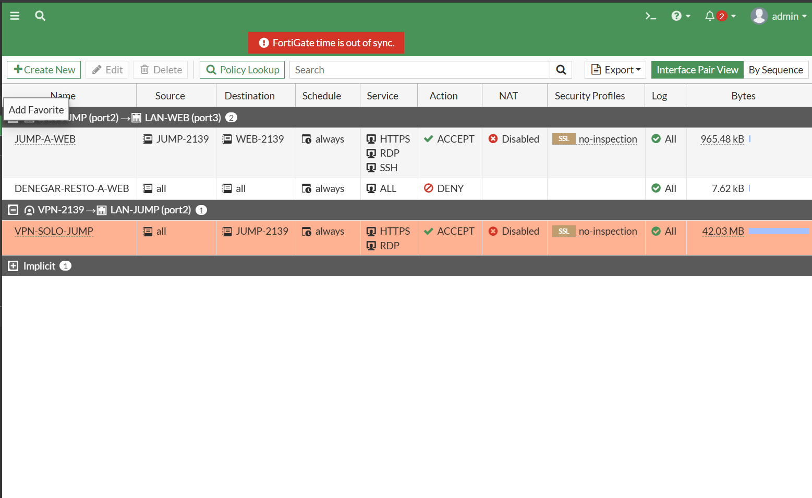

### VPN usuario establecida; IP virtual .200 y selector Jump /32

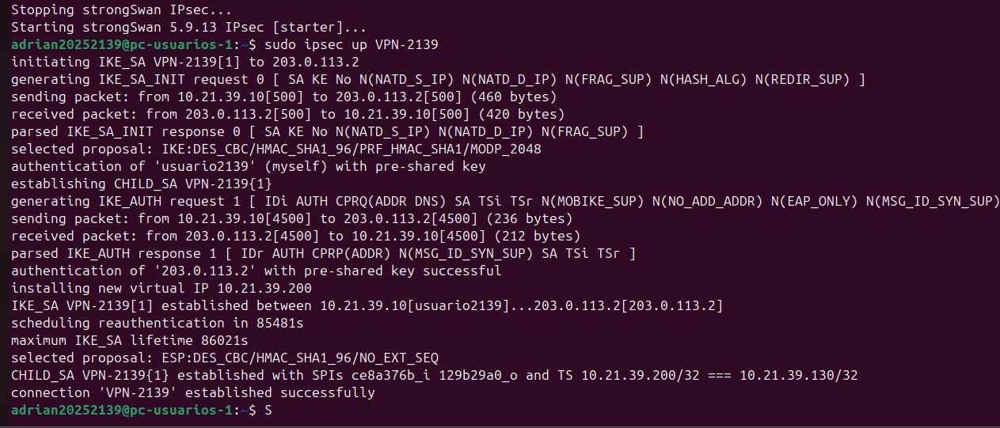

### VPN soporte establecida; IP virtual .201 y selector Jump /32

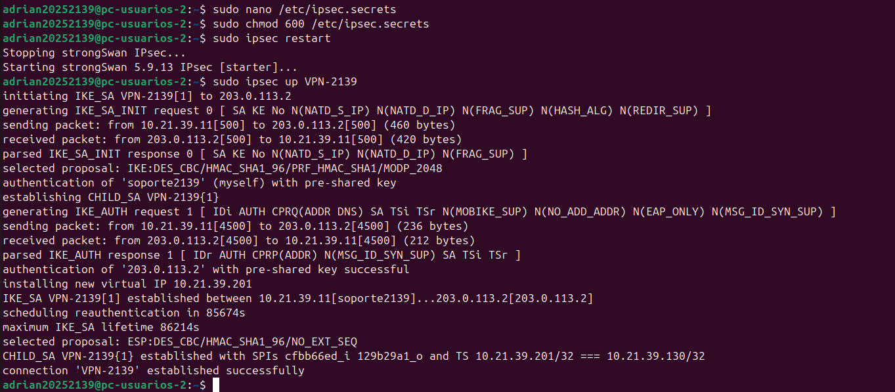

### Catálogo de usuario normal: solamente Caja

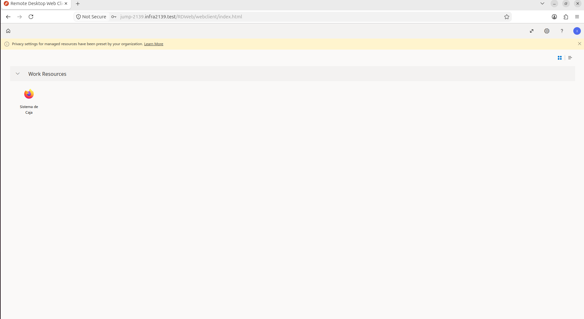

### Venta de RD$150 y cambio de RD$50

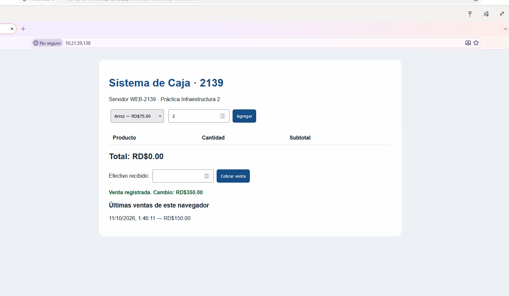

### Catálogo de soporte: PuTTY, RDP y Caja

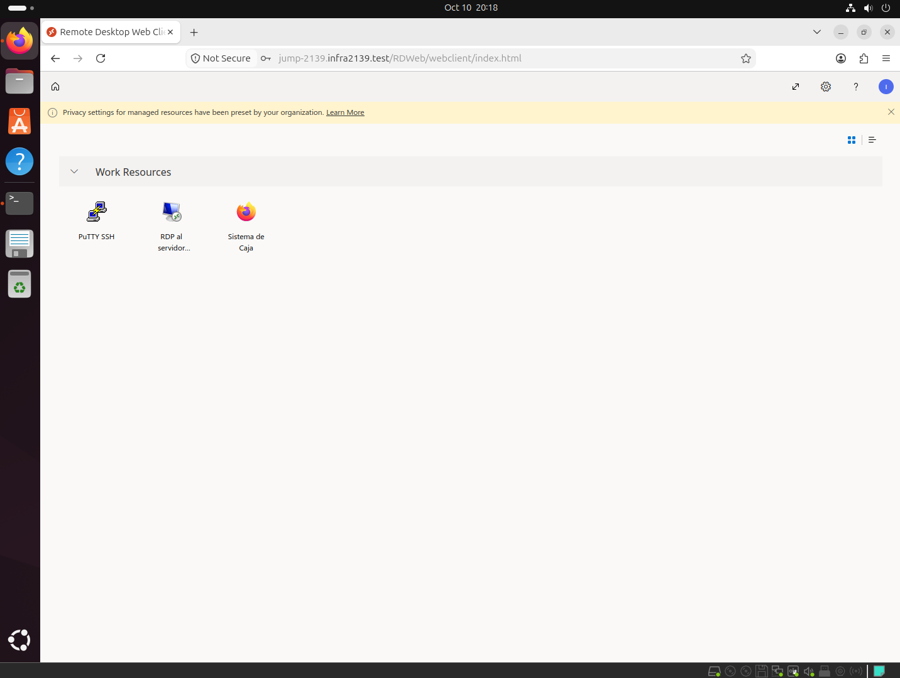

### PuTTY dentro de Web Client: hostname WEB-2139

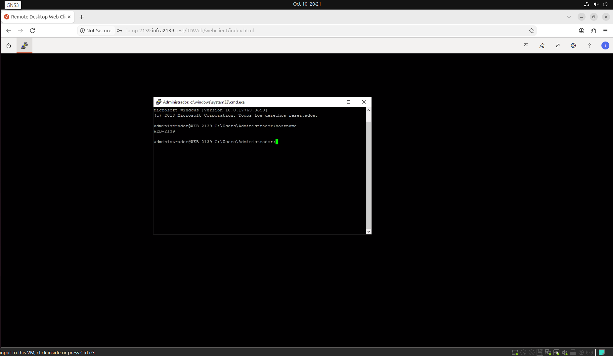

### Escritorio remoto a .138: hostname WEB-2139

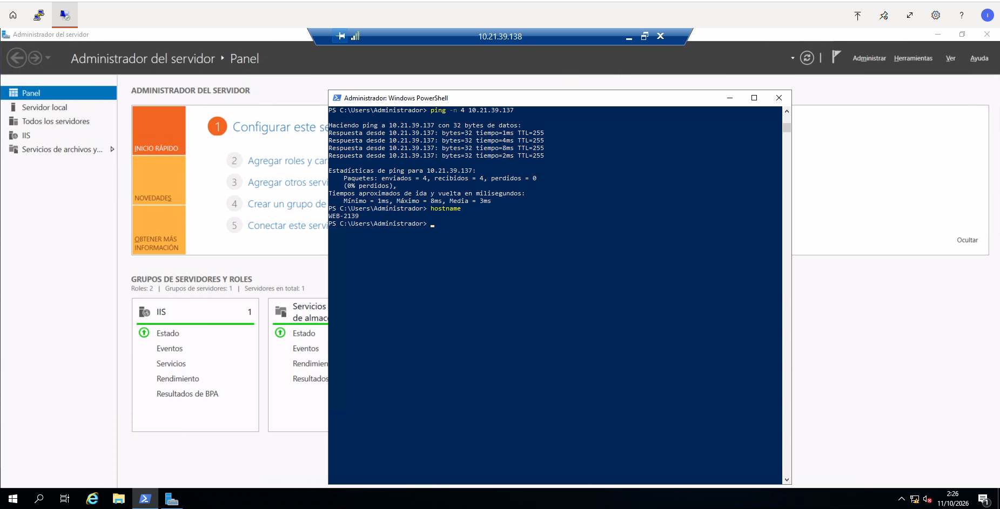

### Identidad usuario2139 en Jump: TCP/22 falla; TCP/443 funciona

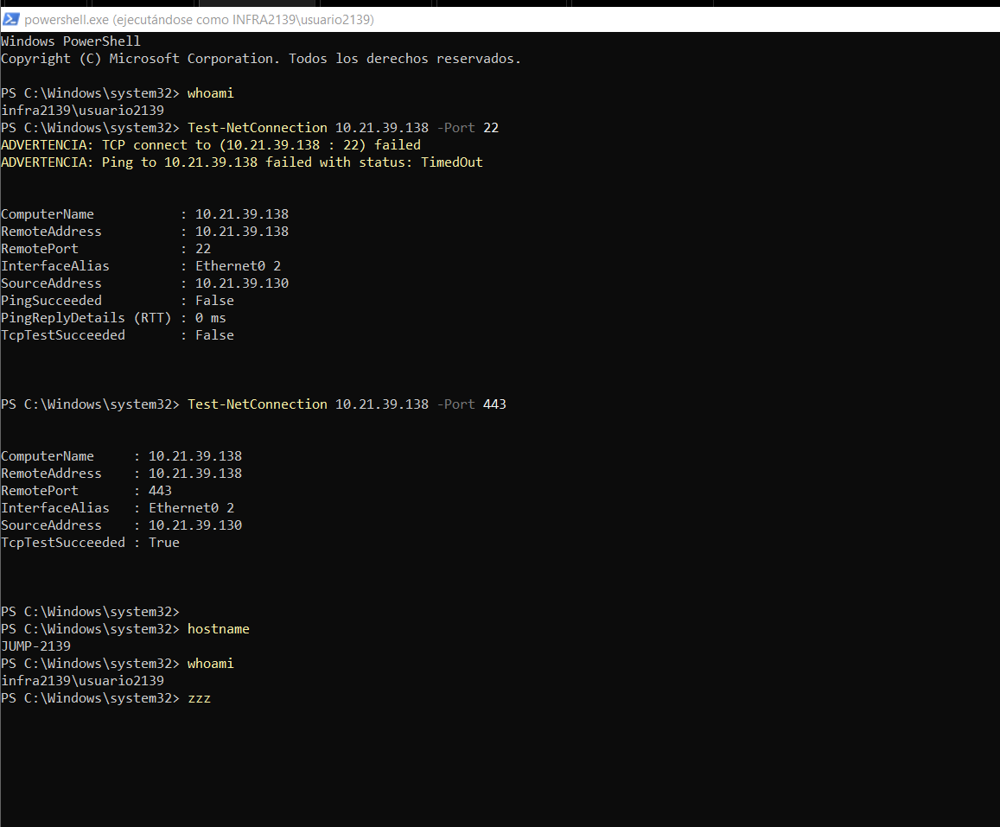

### Cliente no accede directamente a Web TCP/443 ni DC TCP/53

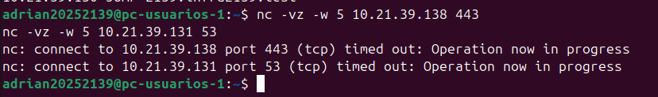

### Jump no establece TCP/445 con Web

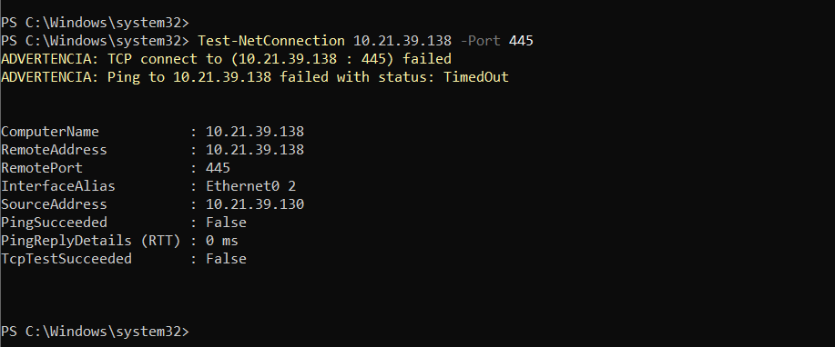

### Tráfico VPN permitido y denegaciones Jump a Web

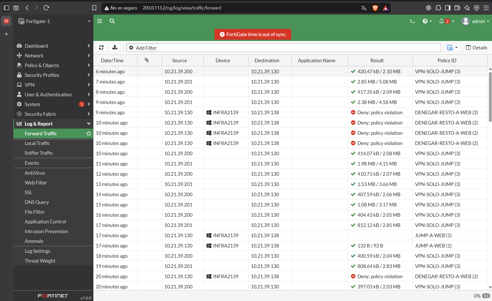

## Interpretación

- Un timeout confirma que no se estableció la conexión, pero por sí solo no identifica el dispositivo que la bloqueó.
- El cliente solo negocia el destino Jump. Los intentos directos al Web/DC pueden quedar fuera del túnel y fallar por ausencia de ruta y/o filtrado. No se atribuye un timeout al FortiGate sin un registro coincidente.
- La captura de logs prueba denegaciones bajo DENEGAR-RESTO-A-WEB; el puerto 445 debe correlacionarse con Details porque la vista general no incluye puertos.
- La regla Windows por SID es necesaria porque FortiGate ve a ambos usuarios salir desde la misma IP del Jump.
- Las capturas del catálogo se atribuyen a las sesiones identificadas durante la práctica; el catálogo por sí solo no expone el nombre completo del usuario.
